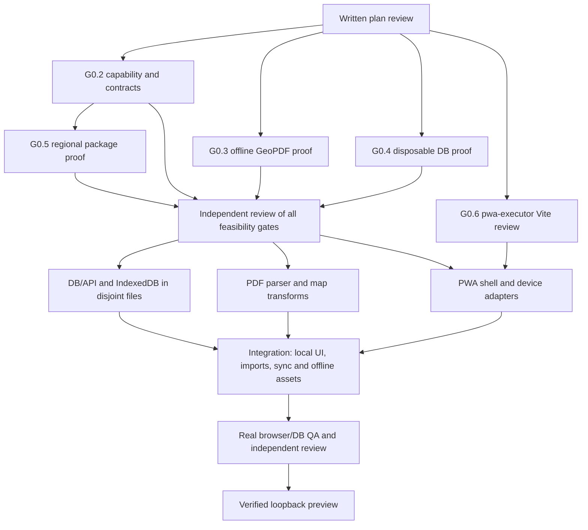

# GeoNexo local-first, GeoPDF and PWA Implementation Plan

> **For agentic workers:** REQUIRED SUB-SKILL: Use superpowers:subagent-driven-development for the explicitly requested parallel execution; use superpowers:executing-plans only if that execution choice changes.

**Goal:** deliver an installable application without login that saves map data/PDFs locally, quietly synchronizes through the API to Neon, locates supported GeoPDFs offline, and shows the user's position on the map and within the PDF.

**Architecture:** preserve React/Vite, MapLibre, Hono, Drizzle/Postgres and shared Zod contracts. IndexedDB is the interactive data source. An anonymous workspace capability protects online API access; immutable operations, version checks and durable cursors handle synchronization. Bundled local PDF parsing/rendering and licensed regional map packages handle offline maps.

**Tech Stack:** existing pnpm/Turbo/TypeScript, React/TanStack, MapLibre/proj4, Hono/Drizzle/postgres-js, IndexedDB, Vitest/Playwright. PDF.js/pdf-lib passed bounded P0 feasibility/license review; exact GeoPDF runtime pins have been added and their lockfile is under independent review. Worker integration remains unimplemented.

**Spec:** [approved-for-planning specification](../specs/2026-09-29-geonexo-localfirst-geopdf.md); [task brief](../tasks/2026-09-29-geonexo-localfirst-geopdf.md).

**Status:** repaired plan passed independent review on 2026-09-30. G0.2 contract/design, G0.3 GeoPDF feasibility, and G0.5 regional source feasibility are **PASS**; local G0.4 PostGIS is **PASS**, while Neon production schema/runtime is **BLOCKED/PENDING** pending a target-specific remote-write approval; G0.6 PWA audit is complete but PWA product acceptance is **FAIL/PENDING**. Both implementation specs and C1 contract-consumer audit passed independent review. `P1-GEO-API` passed parser/API review, including fail-closed rejection of the real Araguaína PDF; worker/render integration remains. P1-PDF exact pins/notices passed review, while attribution of the broad dirty lockfile remains pending, so the dependent PDF.js worker remains gated. L6 passed its final independent review including a Chromium reload/outbox smoke; W0 is PASS-limited to its source/structural gate; W1 code passed review while root integration/cold-offline acceptance remain; D2 has a second repair in progress; W2 exact PMTiles 4.5.0 pin/install/notice passed and package implementation is active. Remote Neon writes, device acceptance, and overall PRD completion remain gated. The user's instruction authorizes PRD execution and parallel agents.

## Global Constraints

- Current checkout is `main`, `D:/MATEUS/Documentos/GitHub/GeoNexo`, as explicitly requested by the user on 2026-09-30. All prior isolated-checkout repairs were copied and verified before removing the duplicate branch/worktree. Keep one branch/folder and disjoint file ownership; no new worktree without a changed user instruction. No commit, push, preview deployment or production mutation implied by this plan.
- API/DB ownership, frontend/maps/geo ownership, tooling/QA and independent review remain separate. Never give concurrent writers the same files; shared contracts and lockfile each have one owner per wave.
- No secrets in browser bundles, docs, logs or test output. No login screen. A public installation UUID does not authorize data access.
- Remote Neon writes, branch creation, or migrations require an explicit approval for the named isolated target. Until then, all schema and sync writes use the named disposable loopback PostGIS target; production remains read-only.
- Every implementation task starts with its named regression, demonstrates failure, implements the smallest change, runs the focused check, reviews the diff, and hands evidence to an independent reviewer. Do not add commit steps without authorization.
- Root owns the final combined verification. Serialize PostGIS tests and builds that share outputs. No DB TRUNCATE/migration without a positively identified disposable target.
- All tasks stop on unsupported CRS/metadata, failed accuracy/licensing/resource proof, unsafe DB target, missing authorization boundary or unresolved review blocker. Preserve selected originals and pending local edits.
- Budgets below are proposed acceptance settings for review. They require measured execution evidence; browser storage and GPS accuracy cannot be guaranteed by a written plan.
- Meaningful worker handoffs include ID, objective, exact scope, dependencies, risk, permissions, commands, results, files, residuals and stop conditions.

## Review Focus

1. One private anonymous workspace per installation; cross-device sharing requires an explicit share capability later.
2. Automatic placement is supported only for metadata/CRS profiles proved by local fixtures. Ordinary PDFs require calibration. GPS accuracy remains the device's reported accuracy.
3. Offline regional map packages include all licensed assets. Downloading a remote style does not download its tiles/glyphs.
4. A designated isolated Neon test target needs explicit remote-write approval. Connector metadata access does not prove application connectivity.
5. Pending/conflicting data receives actionable UI even though routine connectivity transitions stay quiet.

---

## Plan split and task graph

| Plan | Working result | Ownership | Prerequisites |
| --- | --- | --- | --- |
| [Local persistence and Neon sync](2026-09-30-local-persistence-neon-sync.md) | Real local CRUD, protected API, replay-safe synchronization and scoped blob transport | Backend/contracts, client persistence | G0.2/G0.4; global feasibility gate |
| [PDF and georeferenced maps](2026-09-30-geopdf-map.md) | Offline original/document viewer, supported automatic placement and ordinary-PDF calibration | Geo/maps + frontend | G0.3, import/blob contracts |
| [PWA, offline maps and sensors](2026-09-30-pwa-offline-maps-sensors.md) | Relaunch offline, regional basemap, touch UI and permission-safe location/orientation | Frontend/maps + quality | G0.5, local store and PDF adapters |

### Task G0.1 — close baseline repairs and record evidence

**Files:** modify current repair owners' files only; create `docs/quality/2026-09-30-baseline-evidence.md`. This is existing authorized defect work.

- [ ] Finish project-list response/shared creation validation, block unauthorized presigning, correct property formatting, and re-review residuals.
- [ ] Run independent technical review on the final source. Keep DB config snapshot and incomplete product flows explicitly recorded if not repaired.
- [ ] Run root lint/typecheck/test/build without cache, real isolated PostGIS tests, migration compatibility, package audit and three-engine existing E2E. Distinguish shell smoke from full flows.
- [ ] Record exact commands, exits, counts, actual loopback preview URL and material limitations. No baseline pass closes the product goal.

### Task G0.2 — freeze shared boundary and access model

**Files:** create `docs/security/anonymous-workspace.md`, `docs/api/sync-protocol.md`; the single contracts owner creates `packages/contracts/src/workspace.ts`, `sync.ts`, `pdf.ts`, `map.ts`, `offline-map.ts` in this gate and modifies `packages/contracts/src/index.ts` once. Local sync plan Task 1 is this same G0.2 contract implementation, not a task downstream of G0.2.

- [x] Write threat model: lost provisioning response, leaked bearer, revoked access, duplicate device ID, another workspace's IDs and untrusted blobs.
- [x] Specify private bootstrap proof, idempotent recovery, hashed server secrets, revocation and resource caps. Raw proof and bearer use exactly 32 CSPRNG bytes encoded as unpadded base64url; format tests do not prove runtime entropy. Local first launch must succeed before any server response.
- [x] Freeze JSON wire schemas for `SyncOperation`, `PushSyncRequest`, `PushSyncResponse`, `PullSyncResponse`, `ImportMetadata`, `BlobRef`, `GeoReference`, `MapSyncData` and `OfflineMapPackageManifest`; include strict layer projection, 10,000-position geometry cap, signed opaque workspace-bound cursor syntax, and no `serverPayload` for scope rejection. Reuse canonical project/layer/feature schemas and align bounds with database columns before online writes. This is the only production contract definition; feasibility probes consume it and may not create competing wire types.
- [x] Review dependency deletion/version conflict behavior and commit-ordered cursor algorithm with independent backend/security reviewer.
- [x] Gate evidence: reviewed decision record plus fresh contract tests/typecheck and independent schema/security-design review. A G0.2 design PASS does not claim API middleware, provisioning, cursor HMAC, persistence, or data-isolation runtime is implemented; these remain Tasks 2–9 and final QA gates. No capability-sharing scope expansion.

**G0.2 decision:** [GEO-ADR-G0.2-2026-09-30](../decisions/2026-09-30-g0.2-anonymous-workspace-and-sync.md) records the contract/design freeze as **PASS**. Root reproduced the focused contracts suite (3 files / 78 tests) and package typecheck; independent security/design and plan reviews passed the schema/protocol boundary. Runtime controls remain open as the decision record states.

### Task G0.3 — prove client-side GeoPDF feasibility

Run PDF plan task P0 with lawful fixtures and all network disabled. G0.3 now passes for a bounded candidate subset after the user-supplied Araguaína PDF was inspected/rendered and rejected fail-closed for inconsistent EPSG:3857 `/GCS` versus `/GPTS` values, and a valid synthetic EPSG:32620 fixture passed an independent PROJ control check. Record supported profiles/CRS, independent coordinate checks, rotation/insets, accuracy, timing, worker termination and licenses in `docs/maps/geopdf-feasibility.md`. This unlocks only GeoPDF implementation planning; production parsing/rendering still needs an implementation-ready P1 specification, worker/resource limits, and independent product QA. A server-only success does not pass this gate.

### Task G0.4 — prove disposable database and Neon path

**Files:** create `docs/database/disposable-test-targets.md` and `docs/database/neon-schema-drift.md`; modify `packages/db/tests/integration` guards and CI only after review.

- [ ] Reconfirm owned local PostGIS container and standalone test database name; migrate/test locally.
- [ ] Complete PRD §28 metadata audit read-only: identify Neon project and describe it, resolve default branch, list databases and tables, inspect descriptions for `projects`, `maps`, `layers`, `features`, `map_sources`, `imports`, `audit_events`, inspect `postgis`/`pgcrypto` and indexes, compare with `packages/db/src/schema`, and record drift. Do not print connection strings or secrets.
- [ ] Prepare exact isolated Neon branch/database/TTL and non-production identity checks as a reviewable proposal. Creating a branch/database, applying migrations, or writing test rows is a separate remote-write boundary and requires explicit approval for that target.
- [ ] Use server runtime credentials without printing them; prove schema/CRUD/sync round trip via API to that isolated target only after that approval. Local PostGIS evidence does not prove Neon connectivity or schema parity.
- [ ] Existing loopback-only test guard stays active until a separate explicit remote-target guard is reviewed. Never point the local test suite at Neon production.

### Task G0.5 — prove a regional offline map package

Run PWA plan task W0 after the G0.2 contract implementation and independent schema review, using its frozen `OfflineMapPackageManifest`; W0 may use a private test fixture but cannot publish a second contract. Choose a licensed bounded regional archive and complete local style/font/sprite assets, with actual checksum, bytes/zoom coverage and no-network rendering proof. A whole-planet download is not a browser regional package. Bring back any unavailable dataset/license boundary before feature implementation.

**G0.5 source-feasibility result (2026-09-30): PASS.** [Offline package source evidence](../../maps/offline-package-source.md) records a verified 4.3 MB regional PMTiles extract, legal attribution/license provenance, validated 5.24 MB complete manifest, and MapLibre render at DPR 1 and DPR 2 with external requests blocked. Artifacts remain in temporary storage. Product package import/validation/storage/protocol selection and installation remain unimplemented under PWA plan W2; do not read the W0 proof as product acceptance.

### Task G0.6 — execute the required PWA skill against Vite

Apply `$pwa-executor` to the current Vite app and record a PRD-specific checklist at `docs/quality/pwa-executor-review.md`. Preserve the user-mandated Vite + `vite-plugin-pwa` + Workbox architecture: Next.js examples, `next-pwa`, global zoom disabling, Capacitor and push-notification instructions do not apply. Record which relevant install, manifest, SW, cache, offline, update and device checks are already evidenced and which remain pending. This is a required audit/plan input, not proof that PWA acceptance passes.

## Parallel execution and integration order

- **Discovery wave:** backend access/contracts + disposable DB design, GeoPDF feasibility, offline map feasibility. Minimum capable real subagents; root coordinates reviews and shared dependencies.
- **Contracts and feasibility gates:** G0.2 contracts/design, G0.3 GeoPDF feasibility, and G0.5 source feasibility have independent PASS reviews. Local PostGIS passes, but remote Neon schema/runtime remains gated by target-specific approval. A PDF core builder may start only after the implementation-ready P1 spec/task graph is reviewed; import persistence waits for local repository/blob ports; DB/API work waits for its G0.4 runtime gate; PWA/map-package product work waits for G0.6/W2 gates. One tooling owner handles all manifest/lockfile changes; consumers write only after the G0.2 types are independently frozen.
- **Builder wave:** DB/API and IndexedDB repository use separate ownership; PDF geo package and map adapter use separate directories; PWA/sensor adapter avoids pages edited by local-store/PDF integration.
- **Integration wave:** root is the sole writer for `ImportsPage`, `CommandCenterPage`, `SettingsPage`, hooks and router. Other specialists deliver exports/tests, not concurrent edits to these pages. The contracts owner alone edits `packages/contracts/src/import.ts`, `pdf.ts`, `offline-map.ts`, and the contracts index.
- **QA wave:** one quality owner creates the assigned E2E files below; a separate agent performs read-only technical/security review and browser/DB QA. Builders fix findings only within reassigned bounded scope. Root reruns combined checks.

## Final verification task Q5

**Create:** `apps/admin/e2e/local-first.spec.ts`, `local-first-sync.spec.ts`, `import-upload-resume.spec.ts`, `geopdf.spec.ts`, `pdf-calibration.spec.ts`, `offline-map.spec.ts`, `pwa.spec.ts`, `sensors.spec.ts`, `sync-conflict.spec.ts`; fixture helpers under `apps/admin/e2e/helpers/`; `docs/quality/localfirst-acceptance.md`; mandatory `docs/quality/prd-execution-handoff.md`. **Modify:** Playwright config and `.github/workflows` under quality ownership only. One quality owner owns all nine E2E files and their shared helpers; no other worker edits those paths. Root alone owns application pages and merge integration.

- [ ] Boot real local API and identified disposable PostGIS; select runtime/local repositories, never mock sync assertions. Configure Vite proxy using actual API host/port; browser targets loopback only.
- [ ] First launch has no login; create project/layer/feature offline, close/reopen browser context, edit/delete and retain original PDF Blob. Relaunch production shell offline with external requests failing.
- [ ] Reconnect; confirm actual server persistence, push-response loss/replay, pagination/tombstones, cross-workspace denial, local newer-edit preservation and explicit conflict resolution.
- [ ] With network disabled import supported ISO/OGC fixture, inspect map placement and page crosshair/GPS inverse mapping. Corrupt/unknown CRS/encrypted inputs never auto-place; ordinary PDF requires valid control points.
- [ ] Check the supplied project/workspace for a real PDF before using it. If present and legally usable, record only format, CRS, bounds, residual, opening time and approximate memory in the report; do not commit or copy the PDF. If none is supplied, record `NOT AVAILABLE` and do not invent a substitute result.
- [ ] Render an approved regional map package offline with glyphs, labels, sprites and attribution; quota exhaustion preserves unsynced data and offers recovery.
- [ ] Exercise sensor allow/deny/missing API, pause/resume and cleanup. Emulation proves application lifecycle only; record physical Android/iOS checks separately.
- [ ] At a real mobile viewport, record pan/pinch interaction, main-thread long tasks, PDF rendering and list-scroll behavior with representative datasets. Include browser/device, sampling method, observed values and limitations; do not claim unmeasured budgets or physical-device behavior from mocks.
- [ ] Verify keyboard/focus and Escape behavior, accessible names on icon controls, text/contrast and non-color status cues, `prefers-reduced-motion`, and browser zoom. Record manual or automated evidence and unresolved accessibility findings.
- [ ] Inspect PDF handling for zero `eval`/script execution and zero automatic fetching of PDF-embedded links/fonts/scripts. Assert no PDF-originated request escapes the worker/parser.
- [ ] Run lint/typecheck/unit/integration/build/audit and Chromium/Firefox/WebKit; attach traces on failures and independent review record. Do not call skipped remote/physical checks passed.
- [ ] Complete the PRD §52 handoff with the initial audit matrix, reuse/license provenance, preserved features, actual changed paths, Neon metadata/drift/migrations, PWA and GeoPDF/device status, exact command results, concrete pending work, and `PRONTO PARA INTEGRAÇÃO` or `NÃO PRONTO — motivo objetivo`.
- [ ] Start verified build locally, bounded readiness check, open system browser with the configured MAESTRI preview helper if available. Report actual URL and browser-open result.

## Self-review checklist and stop conditions

- [ ] Every spec acceptance item maps to a task and named regression; all new exports/types have a single owner.
- [ ] Five risky inputs have tests: malformed/unbounded JSON; duplicate/out-of-order sync; other workspace's IDs; corrupt/ambiguous/geospatial PDF; truncated or oversized offline package/quota.
- [ ] No task assumes a cursor sequence implies commit order, browser background sync always runs, PDF corner stretching is accurate, or local storage never evicts.
- [ ] Parsing, map package licensing, isolated Neon execution and physical sensor proof are explicit evidence gates with measured failure paths.
- [ ] Stop feature builders until independent written-plan review passes and the applicable G0.2–G0.5 feasibility evidence is approved. PWA shell/mobile builders additionally require G0.6's recorded `$pwa-executor` review. This does not authorize remote Neon writes or override a failed feasibility gate.
- [ ] No release/completion claim unless every PRD §51 item has evidence; unavailable physical device/isolated Neon gates remain explicitly pending and make the result `NÃO PRONTO`.

### Independent planning review record

GEO-REVIEW-PLAN-31 found inconsistent PDF/blob fields, envelope names and an incomplete provisioning-recovery protocol across the first drafts. Revisions unified the PDF schemas and sync envelope names, specified private proof binding/recovery, stable offline workspace IDs, replayed full acknowledgements, immutable predecessor chains, atomic pull/cursor updates and API runtime dependencies. GEO-REVIEW-PLAN-31R confirmed the original contract blockers resolved and requested concrete initial-proof registration, upload status/endpoints and discriminated pull payloads; these have now been written. **GEO-REVIEW-PLAN-31FINAL passed** after independently rereading all four plans.

The continued-execution plan audit then identified missing PRD §28 metadata/drift steps, PWA Executor dependency, real-project-PDF/performance/accessibility/PDF-security checks, §52 handoff, offline-map contract duplication, shared page/contract ownership and Q5 E2E file ownership. The master and child plans were repaired. A fresh independent second review on 2026-09-30 passed those planning findings. This pass is limited to planning quality; it does not pass G0.2–G0.6 evidence or authorize remote Neon writes.

G0.2 contract/design freeze was separately completed after the reviewed map entity, 32-byte token syntax, signed-cursor format, conflict non-disclosure rule and resource bounds were added. The independent reviewer first found an internal conflict in the scope-rejection version sentinel; the schema and tests were corrected and a final re-review passed. This is design evidence only, not runtime authentication or sync proof.

### Measured baseline limitation

Root production Chromium diagnostic on 2026-09-30 confirmed the existing worker active and controlling the page, yet its initial cache contains only the HTML shell, manifest and icons. First offline reload fails to show the app. A subsequent controlled online reload caches the hashed JS/CSS and allows `/projects` offline; `/api/v1/health` correctly fails with a network error rather than cached HTML. W1 must prove complete initial asset precaching and safe updates before offline acceptance.
