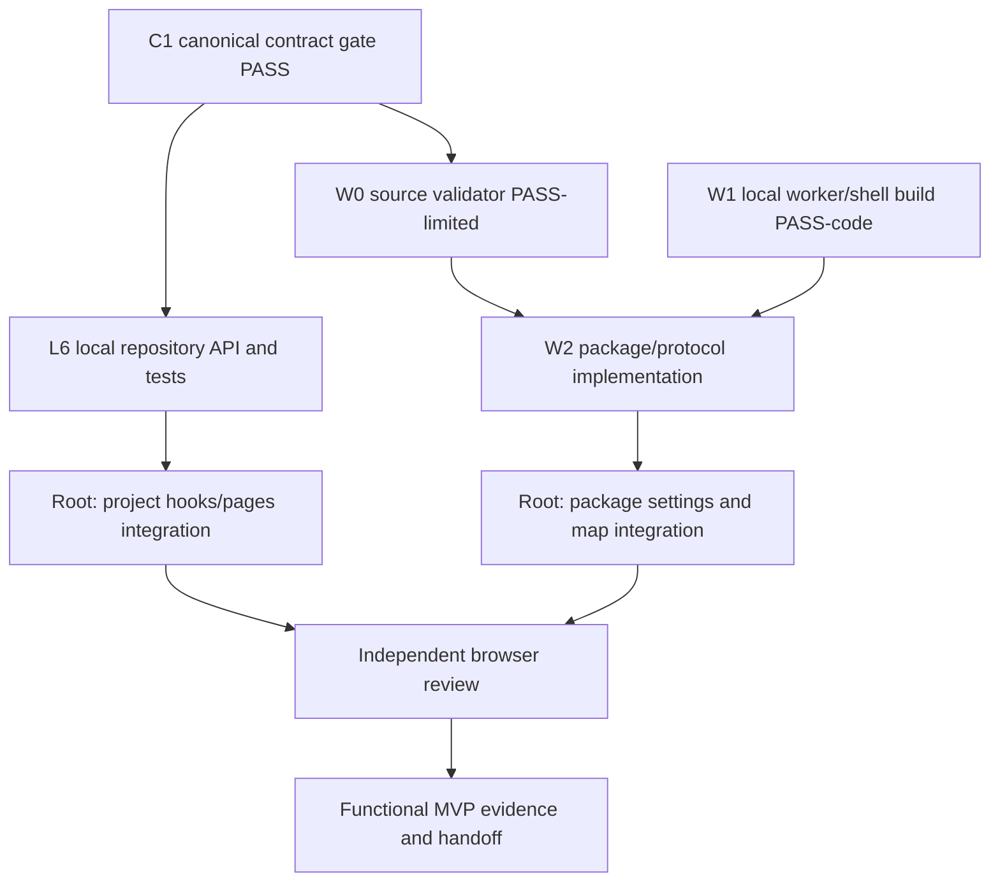

# GeoNexo local functional MVP integration

**Date:** 2026-09-30  
**Status:** implementation-ready; depends on W2 package APIs and L6 local repository API  
**Objective:** connect existing local-first storage to the user-facing map, settings, and project flows so the admin app works without Neon.

## User outcome

The user can install and select an offline map package from local files, open the map without external requests, view an imported local GeoJSON on it, create and reopen a project from this browser, and reopen a local PDF. For the supplied Araguaína PDF, the document remains readable and is explicitly not placed because its declared CRS conflicts with its GPTS values.

## Reuse and constraints

- Reuse `OfflineMapStore`, `createOfflineProtocol`, `createOfflineAssetProtocol`, `adaptOfflineStyle`, MapLibre GL, and the local GeoJSON dataset store already present in the workspace.
- Reuse `LocalRepository.mutate` for atomic entity plus outbox writes, and the L6-owned entity-list API for reads. Do not duplicate local database/schema logic in hooks.
- Use exact pinned `pmtiles@4.5.0`; do not copy PMTiles source. Existing provenance and complete BSD-3 notice remain authoritative.
- No Neon/browser API dependency for local project CRUD; the interface must say `Aguardando sincronização` and must not claim server persistence.
- GeoPDF georeferencing must consume the existing parser result and must not guess/reinterpret contradictory values.
- Root owns changes to existing hooks/pages/router and map integration. L6 owns local repositories/tests. Quality owns shared E2E tests/config. No overlapping writes.

## Dependency-safe task graph

The physical Blob read abort refinement, remote Neon sync, and device acceptance remain deferred. Boundary cancellation and bounded local reads stay in place.

## Implementation tasks

### P — Local projects

- Add a typed repository list operation through the L6 owner, filtered by workspace and entity type, excluding tombstones.
- Root updates project list/detail/create hooks to use that repository. Project records follow canonical `projectSyncDataSchema`; creation uses `LocalRepository.mutate` (`project/upsert`) so entity and immutable outbox entry are atomic.
- Refresh after create and after reload; show the local-only sync status. The project detail must render from IndexedDB even with the API unavailable. Layer editing remains visibly deferred instead of showing a false server error.
- Acceptance: create, view, reload, verify one durable local project and one pending `project/upsert` outbox operation; UI never claims sync completed.

### M — Offline package and map

- Settings accepts a local directory containing `manifest.json`, `package.pmtiles`, the manifest style, glyph, and sprite files. It validates via the W2 store and lists installed packages. Selection is persisted per browser; deletion affects only the selected package.
- On map mount, selected/installed package data are loaded from IndexedDB. Register only `pmtiles` and `geonexo-package` local protocols before creating MapLibre, adapt the validated local style, and serve archive ranges and assets from the package store. Remove handlers on teardown. Do not use the external default basemap as an offline fallback when a local package is selected.
- Keep imported GeoJSON layers visible above the basemap; preserve attribution. No arbitrary remote requests for package style/resources.
- Acceptance: install the licensed temporary G0.5 package, select it, render tiles, labels and sprites, reload with external traffic blocked, see attribution, and overlay a local GeoJSON.

### PDF behavior

- Root integration does not change PDF parser semantics. Confirm the Imports route still opens the local original after reload, renders with the bundled worker, and shows the Araguaína no-position reason.

## Verification and stop conditions

- Focused unit/integration tests, app typecheck and production build.
- Chromium smoke with the actual Araguaína PDF and actual licensed G0.5 temporary package; reload/offline with external requests blocked; capture rendered content, attribution, outbox and request trace.
- Independent reviewer owns the final code/evidence review.
- Stop rather than guess CRS or fetch remote assets. Preserve all pre-existing dirty files and the user PDF. No remote DB writes, commits, push, deployment, process termination, or cleanup.
