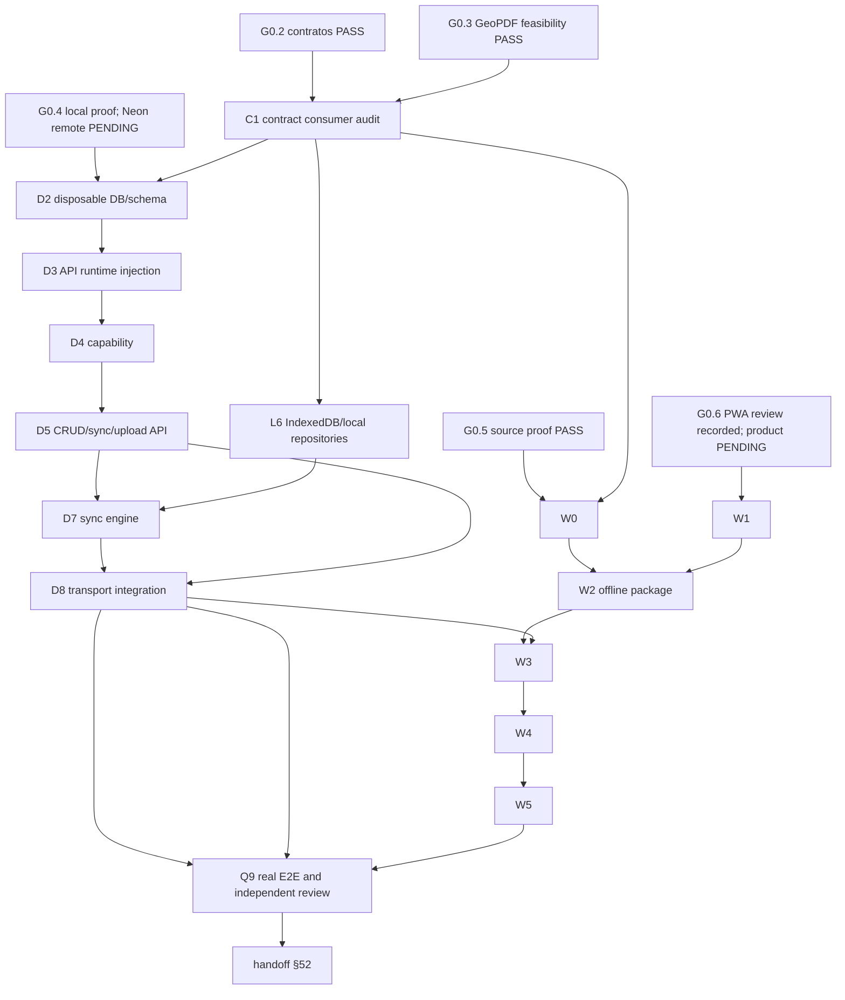

# GeoNexo local-first, PWA, mapas offline e sensores — especificação restante

**Data:** 2026-09-30  
**Status:** `GEO-SPEC-REMAINDER-REVIEW-03 PASS` e `C1-CONTRACT-AUDIT-02 PASS` em 2026-09-30. Builders may start only after each task's remaining listed dependencies. G0.4 remote, G0.6 product, physical-device and overall product acceptance remain pending.  
**Escopo:** implementação restante dos planos de persistência/sync e PWA/mapas/sensores após o freeze G0.2 e a especificação GeoPDF P1.  
**Fora do escopo:** `P1-GEO-API`, `P1-PDF-RUNTIME`, parser/renderizador GeoPDF, mudanças concorrentes em páginas root e qualquer escrita remota no Neon.

## Autoridades e gates

- PRD: `PRD-GEONEXO-PWA-MOBILE-OFFLINE-GEOPDF-NEON.md`, especialmente §§28–29, 40–52.
- Contratos congelados: `packages/contracts/src/{workspace,sync,pdf,map,offline-map}.ts`, `packages/contracts/src/index.ts`.
- Decisão G0.2: `docs/superpowers/decisions/2026-09-30-g0.2-anonymous-workspace-and-sync.md`.
- Planos fonte: `docs/superpowers/plans/2026-09-30-local-persistence-neon-sync.md` e `docs/superpowers/plans/2026-09-30-pwa-offline-maps-sensors.md`.
- Handoff: `docs/quality/prd-execution-handoff.md`.

G0.2 é PASS somente para desenho/contratos; não prova autenticação, persistência, HMAC ou isolamento runtime. G0.3 e G0.5 são provas de viabilidade delimitadas. G0.4 continua pendente: inventário Neon é leitura; branch, migration e escrita remota exigem aprovação explícita para um alvo isolado. G0.6 é revisão específica do Vite/PWA, não aceite de instalação ou cold-offline.

## Regras comuns

1. Um único owner altera cada diretório. O owner de contratos é o único que modifica `packages/contracts/src/workspace.ts`, `sync.ts`, `pdf.ts`, `map.ts`, `offline-map.ts` e `index.ts`. C1 faz auditoria read-only; qualquer alteração exige tarefa aprovada separadamente.
2. O owner de tooling é o único que modifica manifests, lockfile, Vite, Workbox e `public/sw.js`.
3. Root é o único writer das páginas existentes, router, hooks e integração final; workers entregam APIs e testes.
4. `P1-GEO-API` e `P1-PDF-RUNTIME` continuam separados. Import local consome `GeoReference`, `BlobRef` e `ImportMetadata`; não redefine tipos PDF.
5. Nenhuma tarefa usa segredo no browser, conexão Neon no browser, bearer em logs, ou instalação UUID como autorização.
6. Trabalho local usa somente o alvo PostGIS descartável identificado em `docs/database/disposable-test-targets.md`. Migrations, truncates e writes remotos param sem aprovação e sem alvo positivo.
7. Toda tarefa entrega changed paths, comandos/exit codes, evidência, limitações e stop conditions ao revisor independente. Não converter `PENDING` em PASS por mock, cache ou emulação.

## Grafo único

`D2` is blocked until G0.4 local target evidence is fresh; remote Neon work is a separate approval branch and is not a prerequisite for local implementation. `W1` additionally requires the G0.6 review record. `Q9` cannot report product ready while remote Neon, physical-device or cold-offline gates remain pending.

## Task specifications

### C1 — contract consumer audit

- **Owner/files:** contracts owner; read-only review of exactly `packages/contracts/src/{workspace,sync,pdf,map,offline-map,index}.ts`, plans and consumers. This task modifies no contract file; a correction requires a separately approved contract task.
- **Depends:** G0.2 PASS; no G0.4 write.
- **Acceptance:** prove every consumer uses canonical workspace, sync, PDF, map and offline-package types; reject duplicate wire shapes; document bounds and entity/ID discriminants; confirm GeoPDF and map owners do not edit each other’s contracts.
- **Verification/evidence:** focused contract tests, contracts typecheck, `rg` duplicate schemas, diff review.
- **Stop:** contradictory schema, missing owner, or required contract expansion without a new decision record => `[PENDENTE]` and no downstream builder.

### D2 — disposable workspace/PostGIS persistence

- **Owner/files:** backend/database owner only: `packages/db/src/schema/{workspaces,sync,index,projects,layers,features,imports}.ts`, `packages/db/src/queries/{workspaces,sync,projects,layers,features,imports}.ts`, forward migration `packages/db/drizzle/0001_workspace_sync.sql`, and `packages/db/tests/integration/workspace-sync.test.ts`.
- **Depends:** C1; fresh G0.4 local identity and approved loopback target. No Neon target.
- **Acceptance:** workspace-scoped foreign keys; capability hash only; idempotent `(workspace_id,operation_id)`; atomic version/tombstone/sequence; row lock prevents cursor gaps; pull uses verified internal sequence; upload session metadata is scoped; cross-workspace access fails.
- **Verification:** focused integration test with only `TEST_DATABASE_URL` pointing to the named disposable DB; migration exit code; concurrent duplicate/lost-response/stale-version/tombstone/cursor tests. Serialize DB tests.
- **Stop:** ambiguous DB identity, production/default branch target, destructive action without approval, sequence gap, or migration failure.

### D3 — injectable API runtime

- **Owner/files:** API owner: `services/api/src/env.ts`, `services/api/src/server.ts`, `services/api/src/app.ts`, `services/api/src/lib/db.ts`, and existing route wiring only; tests `services/api/tests/server.test.ts`, `services/api/tests/env.test.ts`. D3 does not own any new route module or `routes/workspaces.ts`.
- **Depends:** D2 interfaces; no remote write.
- **Acceptance:** `ApiRuntimeDeps` is injected; no module-time environment/DB singleton; owned server and DB close exactly once; calls after shutdown fail closed; tests never start an uncontrolled listener.
- **Verification:** focused API tests, typecheck, bounded shutdown evidence.
- **Stop:** process-global fallback, leaked listener/DB, unbounded shutdown or secret output.

### D4 — anonymous capability enforcement

- **Owner/files:** API owner: `services/api/src/middleware/workspace-capability.ts` and `services/api/tests/workspace-capability.test.ts`. New route modules are exclusively D5-owned; D4 supplies middleware and capability behavior to them.
- **Depends:** D3 and C1.
- **Acceptance:** 32-byte CSPRNG proof/bearer, unpadded base64url; server stores digest/generation; bootstrap/recovery idempotent and scope-bound; revoked/malformed/empty/guessed installation IDs reject before repository access; highest generation only; no login UI.
- **Verification:** focused negative tests, entropy implementation review, no-secret log scan, API typecheck.
- **Stop:** installation ID accepted as auth, raw proof persisted server-side, capability scope missing, or runtime entropy unproved.

### D5 — CRUD, sync and scoped upload API

- **Owner/files:** API owner exclusively owns new `services/api/src/routes/workspaces.ts`, `services/api/src/routes/sync.ts`, `services/api/src/routes/imports.ts` and their route tests; backend queries from D2 only. D3 and D4 do not modify these route modules.
- **Depends:** D2–D4.
- **Acceptance:** `/api/v1` routes validate strict payloads and 1 MiB bodies; push is idempotent and returns durable acknowledgements; conflicts preserve both sides; cursor MAC is verified and workspace-bound before DB query; server changes have matching entity/ID; PDF upload session is scoped, resumable and never stores large PDF in a row; no arbitrary URL fetch.
- **Verification:** API focused tests for replay, cursor tampering/scope, conflicts, tombstones, upload interruption/resume and body/geometry limits; local integration only.
- **Stop:** cursor decoded before verification, remote storage dependency required for offline open, arbitrary upload destination, or Neon write without approval.

### L6 — IndexedDB/local repositories

- **Owner/files:** frontend persistence owner exclusively owns `apps/admin/src/lib/local-db/**` and `apps/admin/src/lib/local-repositories/**`, plus tests for those directories. `apps/admin/src/lib/sync/**` is exclusively D7-owned and is not modified by L6.
- **Depends:** C1; may proceed locally before D2, but sync transport waits for D5.
- **Acceptance:** versioned stores for entities, originals, operation outbox and conflicts; entity + immutable outbox transaction atomic; reload/quota/interruption preserve unsynced work; local workspace UUID stable; acknowledgements cannot overwrite newer predecessor; originals remain exportable.
- **Verification:** fresh Vitest tests for atomic failure, duplicate/out-of-order operations, quota, reload and conflict preservation; no API/mock assertion.
- **Stop:** silent eviction, localStorage PDF bytes, mutable outbox, or dependency on online capability for first offline edit.

### D7 — client sync engine

- **Owner/files:** frontend persistence owner exclusively owns `apps/admin/src/lib/sync/**` and its focused tests; no `local-db/**`, `local-repositories/**` or page edits.
- **Depends:** D5 and L6.
- **Acceptance:** retry-safe push/upload identifiers; pull pagination preserves opaque cursor; tombstones and conflicts are durable; backoff/deadline; revoked capability is actionable; newer local edit wins over stale acknowledgement without silent merge.
- **Verification:** unit tests with lost responses, duplicate replay, 409/version conflict, cursor pages, network loss and capability revocation; no claim of Neon round trip.
- **Stop:** last-write-wins without action, cursor reset, duplicate durable rows, or bearer in telemetry.

### D8 — transport integration

- **Owner/files:** frontend owner: `apps/admin/src/lib/api-client.ts` and transport consumer tests. Service worker/Vite remains W1 owner.
- **Depends:** D5, D7; actual same-origin `/api/v1` proxy.
- **Acceptance:** no browser DB driver/Neon secret; actual API base is configured, bounded requests and aborts; upload resume does not duplicate; transport does not cache API responses in service worker.
- **Verification:** local API + disposable DB browser tests; network traces; config inspection.
- **Stop:** invented host/port, cross-origin credential leak, service worker API cache, or remote target ambiguity.

### W0 — package product proof after G0.5

- **Owner/files:** maps owner: `packages/maps/tests/fixtures/offline/**`, experimental adapter/tests and `docs/maps/offline-package-source.md`; never duplicate `OfflineMapPackageManifest`.
- **Depends:** C1 and G0.5 source feasibility; no installer claim.
- **Acceptance:** licensed regional source, attribution/fonts/sprites terms, bounded bytes/zoom/extent/hash, PMTiles version/API pinned, local render at DPR 1/2 with network blocked, truncation/path/checksum/resource rejection.
- **Verification:** focused maps tests and rendered evidence. Temporary artifacts are recorded, not silently treated as committed fixtures.
- **Stop:** missing license/provenance, external resource fetch, whole-planet assumption or manifest divergence.

### W1 — shell, deep links and controlled updates

- **Owner/files:** tooling/shell owner: `apps/admin/scripts/generate-shell-manifest.mjs`, `public/sw.js`, `public/manifest.json`, Vite/build wiring, `apps/admin/src/components/pwa/UpdatePrompt.tsx` and service-worker/build-manifest tests. `apps/admin/src/index.tsx` and existing page/router integration are root-owned by a separate integration task; W1 does not modify them.
- **Depends:** G0.6 review record, C1; D8 only supplies API consumer.
- **Acceptance:** generated hashed JS/CSS/lazy-worker/font/icon list; atomic install; no API/map arbitrary GET precache; stable manifest/start URL; update waits for durable writes and compatibility handshake; old cache retained until safe activation; real built app cold-offline launch and deep links work.
- **Verification:** fresh build-manifest tests, old/new worker lifecycle, interrupted install, unknown-asset response, real Chromium/Firefox/WebKit offline launch.
- **Stop:** partial cache activation, API HTML fallback, update losing queued edits, or G0.6/PWA evidence missing.

### W2 — offline package repository/protocol

- **Owner/files:** maps owner: `apps/admin/src/lib/storage/offline-map-store.ts`, `packages/maps/src/offline/{package,protocol,style}.ts`, focused tests; root only package-management page integration.
- **Depends:** W0, W1, C1; no PDF files.
- **Acceptance:** stage archive/assets, verify hash/schema/path/zoom, reserve quota, atomically activate; preserve prior package on interruption; local range/style/glyph/sprite protocol has cancellation and bounded cache; remove affects only selected package; offline restart renders labels/icons/attribution.
- **Verification:** truncation/path traversal/checksum/quota tests and browser restart E2E with network blocked.
- **Stop:** unbounded buffers, silent deletion of PDF/outbox, remote retry loop or unlicensed asset.

### W3 — mobile interaction and quiet sync

- **Owner/files:** frontend UI owner creates `apps/admin/src/components/{layout/MobileNavigation.tsx,pwa/InstallAction.tsx,sync/SyncStatus.tsx}`; root alone modifies existing pages; tooling owns global styles.
- **Depends:** W1, W2, D8; no sensor permission implementation.
- **Acceptance:** 44 CSS-pixel targets, accessible names/focus/Escape/dialogs, safe-area/landscape/bottom-sheet behavior, contrast/non-color status/reduced motion/browser zoom; quiet routine connectivity; actionable pending/conflict/storage/revocation state; install prompt claims only observed state.
- **Verification:** mobile Chromium/WebKit flow, screenshots and independent visual/accessibility review.
- **Stop:** inaccessible controls, data-loss hidden state, or claims of installation/permission without evidence.

### W4 — optional location/orientation

- **Owner/files:** maps/device owner: `packages/maps/src/device-location.ts`, maps exports, `packages/maps/tests/device-location.test.ts`, `apps/admin/src/components/maps/LocationControls.tsx`; integration owner only consumes pose.
- **Depends:** W3 and map/PDF adapters; physical evidence remains separate.
- **Acceptance:** start only from user gesture; typed `DevicePose`; deny/missing/NaN/stale/repeat/hidden/dispose paths; stop watchers on hide; no true-north claim for unreferenced gyro; no upload unless explicit local track using sync contract; optional wake lock released.
- **Verification:** unit/browser emulation plus separately recorded Android/iOS checks. Emulation cannot PASS physical gate.
- **Stop:** permission at load, listener leak, implicit tracking/upload, or missing device evidence recorded as PASS.

### W5 — recovery and browser acceptance

- **Owner/files:** frontend storage owner: `apps/admin/src/lib/storage/quota.ts`, `apps/admin/src/components/storage/StorageRecovery.tsx`; named Q5 E2E files remain quality owner; local store/settings fixes stay with owners.
- **Depends:** D8, W1–W4.
- **Acceptance:** quota failures leave no partial success; versioned recovery export/import validates schema/hash/bounds and excludes bearer by default; production install/update/offline deep links, package/PDF/outbox retention and sensor cleanup verified.
- **Verification:** fresh browser engines, identified mobile viewport/device, memory/long-task sampling and recovery tests; physical/remote gaps remain explicit.
- **Stop:** partial recovery, credential export, or skipped device/remote checks represented as passed.

### Q9 — integrated QA and §52 handoff

- **Owner/files:** quality/security owner exclusively creates exactly `apps/admin/e2e/local-first.spec.ts`, `apps/admin/e2e/local-first-sync.spec.ts`, `apps/admin/e2e/import-upload-resume.spec.ts`, `apps/admin/e2e/geopdf.spec.ts`, `apps/admin/e2e/pdf-calibration.spec.ts`, `apps/admin/e2e/offline-map.spec.ts`, `apps/admin/e2e/pwa.spec.ts`, `apps/admin/e2e/sensors.spec.ts`, `apps/admin/e2e/sync-conflict.spec.ts`, their files under `apps/admin/e2e/helpers/`, `docs/quality/localfirst-acceptance.md` and `docs/quality/prd-execution-handoff.md`. Root reruns combined verification and does not edit these paths. No other worker edits Q9 paths.
- **Depends:** D8, W5, GeoPDF P1 gate, independent reviews; G0.4 remote and physical checks may remain pending.
- **Acceptance:** real local API/DB, offline CRUD/reload, sync replay/conflicts/tombstones, supported GeoPDF, ordinary-PDF calibration, offline package, PWA install/deep links, sensors, accessibility, PDF no-network/security, three engines, fresh lint/typecheck/unit/integration/build/audit. Handoff includes PRD §52 matrix and `PRONTO PARA INTEGRAÇÃO` only when all mandatory gates pass; otherwise `NÃO PRONTO — motivo objetivo`.
- **Verification:** actual commands, traces/screenshots, loopback URL/readiness, independent technical/security review and `git diff --check` for docs.
- **Stop:** mocked sync, Neon production target, missing physical evidence, unbounded resource result, or any unresolved independent review blocker.

## Verification command matrix

Commands are run fresh, with shared DB/build outputs serialized. If a package script is absent, the owner records `[PENDENTE: script não disponível]` rather than substituting a broad or cached command.

| Task | Required focused verification |
|---|---|
| C1 | `pnpm exec vitest run packages/contracts/tests/sync.test.ts packages/contracts/tests/contracts.test.ts packages/contracts/tests/import.test.ts`; `pnpm --filter @geonexo/contracts typecheck`; `git diff --check -- docs/superpowers/specs/` |
| D2 | `pnpm --filter @geonexo/db exec vitest run tests/integration/workspace-sync.test.ts --maxWorkers=1` with only the approved loopback `TEST_DATABASE_URL`; migration command and target identity recorded before execution |
| D3–D5 | `pnpm --filter api exec vitest run tests/server.test.ts tests/env.test.ts tests/workspace-capability.test.ts`; API typecheck; route tests for sync/import; no production URL |
| L6–D8 | frontend persistence/sync focused Vitest files selected by the owner; API client typecheck; browser trace proving `/api/v1` and no service-worker API cache |
| W0–W2 | package/map focused Vitest files; offline protocol test with network blocked; real browser restart E2E; archive/hash/path/quota evidence |
| W1 | shell-manifest/service-worker tests, production build, then Chromium/Firefox/WebKit built-app offline launch with deep links |
| W3–W5 | mobile Chromium/WebKit E2E, accessibility/visual evidence, quota/recovery tests, identified device/viewport memory and long-task sampling; physical checks separately recorded |
| Q9 | root fresh lint/typecheck/unit/integration/build/audit, all nine Q5 Playwright files, independent security/technical review, and `git diff --check` |

## Final gate and unresolved evidence

This specification permits local/disposable implementation in the listed ownership boundaries after its independent review. It does not authorize remote Neon branch creation, migration, schema write, row write, deployment or production change. G0.4 remote schema/runtime remains `[PENDENTE]`; G0.6 product install/cold-offline remains `[PENDENTE]`; physical Android/iOS sensor evidence remains `[PENDENTE]` until actually captured. Any unavailable source, device, memory measurement or target identity must remain `[PENDENTE]`, never be inferred.

## Independent review record

- **2026-09-30 — `GEO-SPEC-REMAINDER-REVIEW-03 PASS`:** independent review confirmed the superseding G0.3 feasibility-only status, exact exclusive ownership paths, acyclic task graph, remote/device approval boundaries and lawful reuse scope. The local FlatGeobuf checkout was verified as BSD-3-Clause; its mismatch with the PRD's BSD-2 label is explicitly `REFERENCE_ONLY / BLOCKED`, with no adoption or copying until the owner resolves it. This is planning approval, not implementation or product acceptance.
- **2026-09-30 — `C1-CONTRACT-AUDIT-02 PASS`:** independent read-only review confirmed GeoNexo PDF wire types are imported from `@geonexo/contracts`, the package declares its workspace dependency, public results match the canonical schema, and no duplicate wire schema or contract edit was introduced. This unlocks D2/L6/W0 only where their other task-specific dependencies pass.

## Reuse and dependency decisions

Every task follows this order: existing GeoNexo API/adapter first; an already installed package second; an official model/package only when its API and license fit; selective source port last, with independent review. No candidate below authorizes copying before the owning task records the actual diff.

| Task | Candidate/path and exact reusable unit | License/provenance evidence | Decision, destination and dependency gate |
|---|---|---|---|
| C1, D2–D8, L6 | Existing GeoNexo Zod, Hono, Drizzle, IndexedDB and API clients; only their current public utilities and schemas | Repository source and G0.2 decision are canonical; no third-party source reuse | **USE existing**. Keep contracts in `packages/contracts`, DB/API in assigned owners, local persistence in `apps/admin`; no new dependency. |
| W0/W2 | Official Protomaps regional PMTiles extract and its local style, glyph and sprite assets recorded in `docs/maps/offline-package-source.md` | Report records source URL, license/attribution, SHA, PMTiles v3/MVT, bounds and temporary-artifact limitation; product terms remain to be rechecked by W0 | **USE only after W0 acceptance**. Store verified archive/assets through the canonical manifest; do not copy a whole provider or assume remote URLs. |
| W2 | Official PMTiles/FileSource package/API, if the W0 report and target browser support confirm it | Package version, license, integrity and API must be recorded by tooling owner; no package is approved from a model tree | **PREFER installed/official package**. Add dependency only through the tooling owner and frozen lockfile; otherwise implement a narrow local range reader in `packages/maps/src/offline/` after review. |
| W2 | Local model `pmtiles@4.5.0`; `FileSource` range reads and `AbortSignal` cancellation | Local package is BSD-3-Clause; exact installed version and package provenance must be recorded by tooling owner | **OFFICIAL DEPENDENCY CANDIDATE**. Prefer it for `packages/maps/src/offline/protocol.ts` only if W0 API/target review passes; no source copy. |
| W2 conditional | Supercluster model/package for measured large-feature clustering | ISC license; use only after a reproducible workload demonstrates clustering is required | **CONDITIONAL**. No dependency or code port until measurement and maps-owner approval; destination would be a bounded maps adapter. |
| W2 conditional | Local checkout `REPOSITORIOS MODELOS/flatgeobuf-master/flatgeobuf-master`, only as a model for a proven large-vector workload | Local `LICENSE` and `package.json` declare BSD-3-Clause. This conflicts with the PRD/source assumption and requires product-owner resolution; exact package/version and data-path still need independent review | **REFERENCE_ONLY / BLOCKED**. No code copy or dependency adoption until the PRD-vs-checkout license discrepancy is resolved by the product owner and W0/W2 proves the need. |
| W1 | Existing Vite/vite-plugin-pwa/Workbox configuration and current service-worker policy | Current repository configuration plus G0.6 Vite-specific review | **USE existing**. Do not import Next.js, `next-pwa`, Capacitor or unrelated service-worker examples. |
| W3 | Existing GeoNexo design system and MapLibre controls | Repository-owned components; accessibility evidence must be fresh | **USE existing**. No copied UI library or new global styling dependency without a separate decision. |
| W3 conditional | `use-gesture` model for touch gesture handling | MIT; add only if focused interaction evidence shows existing MapLibre/design-system handling is insufficient | **CONDITIONAL OFFICIAL DEPENDENCY**. No dependency before W3 proof; destination would be the dedicated mobile interaction component. |
| W4 | Browser Geolocation and DeviceOrientation APIs | Official browser/platform API documentation; runtime support and permissions are device-dependent | **USE platform APIs**. No sensor library is justified unless the official API cannot meet a proved requirement and its license/version is reviewed. |
| W4 conditional | Capacitor geolocation model | MIT, but it targets native wrappers rather than the current browser PWA | **REFERENCE_ONLY** for this browser PWA; do not add Capacitor or copy its implementation. |
| W1/W3 reference | GeoLibre app model | MIT, but it is a complete Tauri application rather than a focused reusable package | **REFERENCE_ONLY**. Do not copy the app; use only publicly documented ideas if independently reimplemented. |
| W3 reference | React Virtuoso local model | No local license/provenance evidence found | **REFERENCE_ONLY**. Do not copy or add as dependency until verified. |
| W1/W2 reference | Dexie, Workbox or Vite PWA local model trees | No suitable local model was found for these tasks; current project dependencies/configuration remain authoritative | **NO REUSE DECISION**. Use existing project APIs/configuration and record `[PENDENTE]` if a new dependency becomes necessary. |
| D5 upload | Existing local/blob transport adapter and approved server Object Storage boundary, if later enabled | PRD and target-specific Neon/Object Storage approval; no browser credentials | **DEFER remote adapter** until explicit target approval. Local original/blob staging remains the required path. |
| Any remaining task | `REPOSITORIOS MODELOS/kerilla-map-main` or other unlicensed/reference-only tree | No verified LICENSE/COPYING/NOTICE or origin is sufficient | **REFERENCE_ONLY**. Do not copy, port or add as dependency. |

TacMap, PDF.js, pdf-lib and GeoPDF-specific ports belong to the approved GeoPDF P1 specification and are not reusable implementation ownership for these tasks. If a builder proposes a different model/package, it must provide exact path/API, source URL/version or `commit unavailable`, license/notice and content hash before implementation; otherwise record `[PENDENTE]` and stop.
